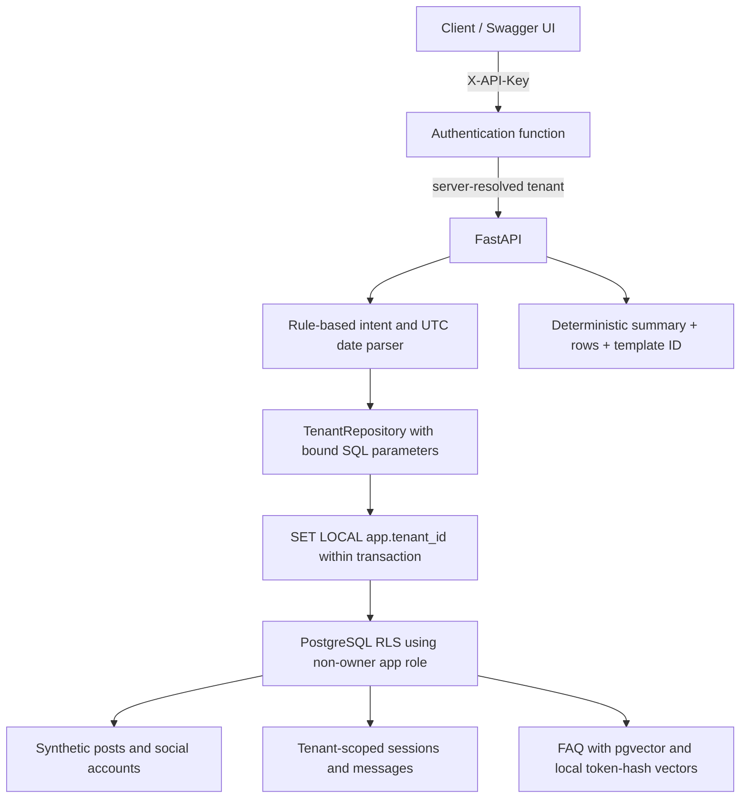
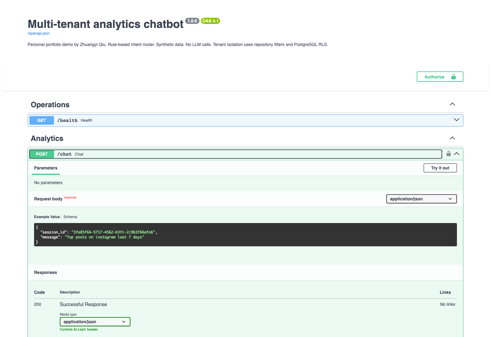
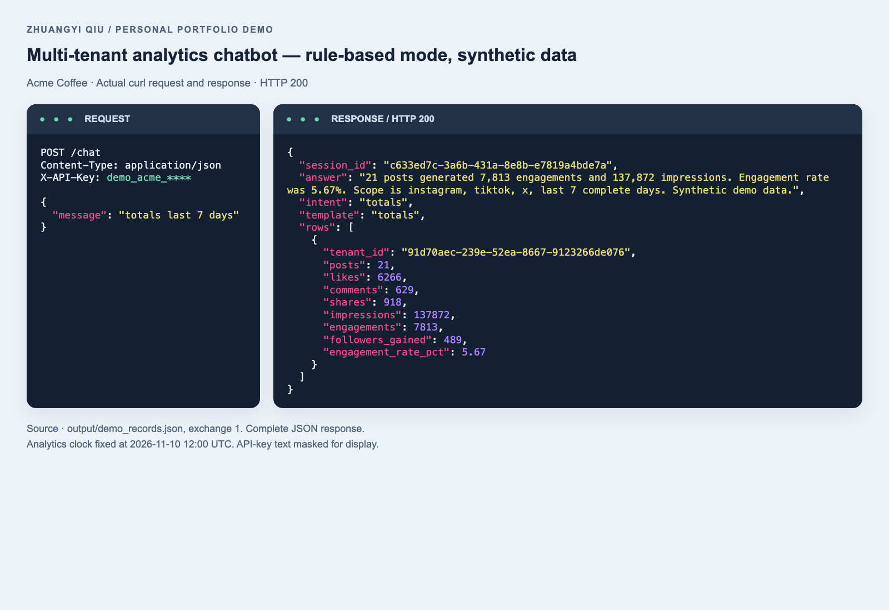
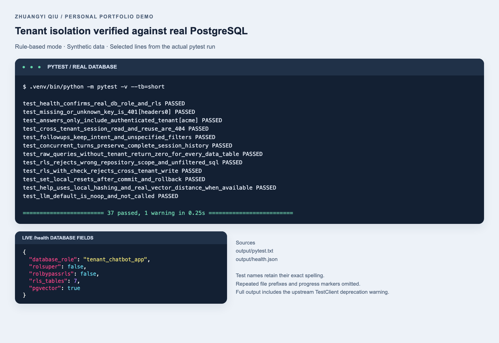

# Multi-tenant AI data chatbot

> **Personal demo project (not client work).** Built by Zhuangyi Qiu as an Upwork portfolio sample.
>
> **Stack:** Python 3.12, FastAPI, PostgreSQL 16 + pgvector, Row-Level Security, psycopg 3, Docker Compose, pytest, Playwright (screenshots)
> **Tests:** `.venv/bin/python -m pytest -v` (37 passed; needs the Docker database running)
> **Screenshots** below were captured in **rule-based mode with no LLM**: answers come from fixed SQL templates and deterministic summaries.
> **License:** MIT

Personal demo project by **Zhuangyi Qiu** for an Upwork portfolio. All three organizations, accounts, posts, metrics, and credentials are fictional. This project was created as a personal demonstration.

**Demo mode. Rule-based intent router. No LLM calls. Synthetic data.** No paid API, API-key environment variable, model download, or signup is used. The title describes an analytics-chatbot architecture. Answers in this implementation come from deterministic Python summaries and fixed SQL templates.

## Architecture



## Run locally

Run all commands from this folder. Docker Desktop must be running. The database is bound to `127.0.0.1:55432` and the API to `127.0.0.1:8000`.

Use **Python 3.12**. Playwright is only needed if you want to regenerate the portfolio screenshots.

```sh
python3.12 -m venv .venv
.venv/bin/python -m pip install -r requirements.txt
# optional, for screenshot regeneration only:
.venv/bin/playwright install chromium

docker compose up -d --wait
.venv/bin/python -m app.migrate
.venv/bin/python -m app.seed
.venv/bin/python -m uvicorn app.main:app --host 127.0.0.1 --port 8000
```

Open `http://127.0.0.1:8000/docs`. Swagger uses its standard CDN-hosted UI assets, so the docs page needs access to that CDN. The API and analytics execute locally. The migration and seed commands are rerunnable. Seeding upserts the same fixtures and preserves existing chat history.

The compose default is `pgvector/pgvector:pg16`. If its initial pull fails, use `POSTGRES_IMAGE=postgres:16 docker compose up -d --wait`. The migration detects whether the vector extension is available. Without it, FAQ answers use a small tenant-filtered SQL fallback. The completed run used pgvector.

### Public synthetic demo credentials

These are deliberately published local fixtures. The database role passwords are also local demo values in `docker-compose.yml` and `app/config.py`.

| Fictional tenant | X-API-Key |
| --- | --- |
| Acme Coffee | `demo_acme_local_only` |
| Bluebird Fitness | `demo_bluebird_local_only` |
| Nova Books | `demo_nova_local_only` |

```sh
curl --silent --show-error http://127.0.0.1:8000/chat \
  -H 'X-API-Key: demo_acme_local_only' \
  -H 'Content-Type: application/json' \
  --data-binary '{"message":"totals last 7 days"}'
```

The optional `DATABASE_URL` and `DATABASE_ADMIN_URL` settings override the local defaults. The API uses the app URL. Only migration, seed, and the read-only administrative verification script use the admin URL.

## API and session memory

| Route | Behavior |
| --- | --- |
| `POST /chat` | Accepts `{ "session_id"?: "uuid", "message": "text" }`. Returns `session_id`, `answer`, `intent`, `template`, and `rows`. |
| `GET /sessions/{id}` | Returns the authenticated tenant's session context and ordered user/assistant messages. |
| `GET /health` | Checks PostgreSQL and reports mode, fixed clock, extension, database role flags, and RLS-table count. |

Authentication is required for chat and history. Missing or unknown keys return 401. A foreign or absent session returns 404 on both reads and follow-up writes. Malformed messages, unsupported questions, invalid dates, extra body fields, and a `tenant_id` query parameter return 422. The request schema has no tenant field.

Reuse the returned session UUID with `what about tiktok?`, then `and last month?`. The previous intent and unspecified platform/date filters are retained. A fresh session has no previous context. Explicit new intents also retain unspecified session filters. A comparison requires exactly two platforms. A help turn becomes the current intent, so start a new analytics question before another filter-only follow-up.

Each turn uses one database transaction. Existing sessions are locked with `SELECT ... FOR UPDATE`, serializing concurrent turns. Messages and context commit together. Failures roll back the complete turn.

## Eight whitelisted templates

| Intent / template | Example | Calculation |
| --- | --- | --- |
| `top_posts` | top posts on instagram last 7 days | Five posts ranked by likes + comments + shares, descending. |
| `worst_posts` | worst posts last month | Five posts ranked by the same count, ascending. |
| `engagement_rate` | engagement rate by platform last month | `100 * SUM(likes + comments + shares) / SUM(impressions)`. |
| `follower_growth` | follower growth this week | Sum of synthetic followers gained attributed to posts, grouped by platform. |
| `best_posting_time` | best posting weekday and hour last month | UTC weekday/hour buckets ranked by mean engagements per post, including sample counts. |
| `totals` | totals last 7 days | Counts, sums, and weighted engagement rate over matching posts. |
| `compare_platforms` | compare instagram vs tiktok last month | The same aggregate metrics for exactly two named platforms. |
| `help` / `help_faq` | what can you answer? | Tenant-scoped FAQ nearest-neighbor lookup with local hashing vectors. |

Supported platforms are `instagram`, `tiktok`, and `x`. Questions are matched using English keywords and regex. The router never generates SQL. Question text cannot become SQL identifiers, ordering clauses, or executable expressions. All data filters use bound parameters. No matching posts produces an empty row list and an explicit no-data answer.

### Reproducible dates and fixtures

The analytics clock is fixed at **2026-11-10 12:00 UTC**. The seed contains 90 complete UTC days from **2026-08-12 through 2026-11-09**, one post per tenant/platform/day. There are 270 posts per tenant and 810 in total. Captions are marked `[SYNTHETIC]`. UUIDs, random metrics, and dates are deterministic.

- `last N days` selects N complete days before the fixed clock's date, with 1–3660 accepted.
- `last month` selects the previous calendar month, October 2026 in this demo.
- `this week` starts Monday at 00:00 UTC and ends at the fixed clock.
- `this month` starts the first of the month and ends at the fixed clock.
- `from YYYY-MM-DD to YYYY-MM-DD` includes both stated dates, using an exclusive next-day upper bound.
- `all time` selects the seeded 90-day window. A new session otherwise defaults to the last 30 complete days.

## Two tenant-isolation layers

1. **Repository boundary.** The authenticated key resolves a tenant UUID on the server. Every tenant-data operation goes through `TenantRepository`, whose constructor requires a UUID. Reads and updates contain `WHERE tenant_id = %(tenant_id)s`. Inserts bind the server-resolved tenant. Composite foreign keys prevent cross-tenant account and session relationships. Authentication, administrative bootstrap, and operational metadata are the explicitly separate paths described below.
2. **Database boundary.** All seven data tables have `tenant_id`, enabled and forced RLS, and a policy with both `USING` and `WITH CHECK` against `NULLIF(current_setting('app.tenant_id', true), '')::uuid`. Every tenant-data transaction issues `SET LOCAL app.tenant_id`. Missing or reset settings produce zero visible rows. Commit and rollback reset the setting before a connection can be reused.

The API logs in as `tenant_chatbot_app`, a non-owner role with `NOSUPERUSER` and `NOBYPASSRLS`. Startup verifies these properties and all seven forced-RLS tables. The role has read access to seeded tables and only the chat insert/update privileges needed by the handlers. It cannot delete fixtures.

**Pre-tenant authentication exception.** A key must be resolved before a tenant transaction can start. `auth.resolve_api_key(text)` is a narrowly scoped, parameterized `SECURITY DEFINER` function owned by the migration administrator. Its fixed body returns only the tenant/user UUIDs matching the supplied key. It fixes its search path, fully qualifies `public.users`, revokes public execution, and grants execution to the app role. Direct unscoped queries against `users` still return zero rows. Health queries inspect system metadata. Migration and synthetic seeding run as the separate administrator.

RLS trusts the service's selection of the transaction setting. Protecting a shared database login and administering tenant settings belong to the server trust boundary. Demo API keys are stored in plaintext solely for this published local fixture.

## pgvector and optional adapter

Each tenant has three FAQ records. A deterministic SHA-256 token-hash function produces normalized 64-dimensional vectors locally. SQL orders by cosine distance with `<=>` and returns the nearest FAQ entry. Nine records are small enough for an exact scan. This demonstrates **pgvector plumbing**. Hash collisions, token overlap, and the absence of a trained model limit retrieval quality. The numeric distance is included in the returned JSON.

`app/llm.py` provides a protocol, `NoopLLM`, and an `OpenAICompatibleLLM` endpoint stub. The default flag is `LLM_ENABLED=false`. Setting it to true selects the stub, which raises `NotImplementedError` if directly invoked. The analytics path does not call either adapter. There is no HTTP implementation or credential lookup in this module. No OpenAI or Anthropic SDK is installed. `command -v ollama` found no executable on this host. Ollama was never installed, started, or contacted.

## Verify and reproduce portfolio images

Keep the API running in the first terminal and execute the following in another terminal in this folder.

```sh
.venv/bin/python -m pytest -v --tb=short > output/pytest.txt 2>&1
cat output/pytest.txt
.venv/bin/python scripts/demo.py > output/demo-run.txt 2>&1
curl --fail --silent --show-error http://127.0.0.1:8000/health > output/health.json
.venv/bin/python scripts/verify_database.py > output/database_verification.json
.venv/bin/python scripts/capture_portfolio.py > output/portfolio-capture.txt 2>&1
```

Pytest runs FastAPI's normal handlers and authentication through TestClient, with the real PostgreSQL container and actual app role. Separate curl exchanges exercise the live uvicorn server. Coverage includes three tenants, all eight templates, cross-tenant reads and writes, unscoped raw RLS queries for every table, missing/unknown keys, request-tenant rejection, commit/rollback context reset, concurrent session turns, date parsing, no-op LLM behavior, and local FAQ retrieval.

`scripts/demo.py` executes real curl subprocesses. It saves complete responses and masks only credential text in displayed request commands. `scripts/capture_portfolio.py` uses headless Playwright Chromium to screenshot the actual `/docs` UI and render saved run evidence. It checks PNG dimensions and page overflow.

These screenshots were captured in **rule-based demo mode with no LLM**.







The first image is the real Swagger UI with POST `/chat` expanded. The second is a complete actual request/response from the first curl exchange. The third shows selected exact test lines and the actual pytest summary, plus live health fields. Repeated test-file prefixes and progress percentages are removed for readability. The complete warning and all test output remain in `output/pytest.txt`.

After verification, stop uvicorn with Ctrl+C in its terminal and stop only this compose project's database.

```sh
docker compose stop
```

The named Docker volume retains the fixtures and history. The delivered project leaves the API stopped and `tenant-chatbot-db` stopped.

## Limitations

This is a local portfolio demo with fixed synthetic fixtures and a fixed clock. English keyword matching covers a constrained question set. Posting-time comparisons are descriptive and reflect small synthetic buckets. The follower metric is per-post attribution. Hash vectors provide basic token matching. The endpoint adapter is a stub. Published plaintext fixture credentials, missing key rotation/rate limits, and a shared app database login limit deployment suitability. Swagger's CDN dependency and an upstream TestClient deprecation warning are known limitations.
